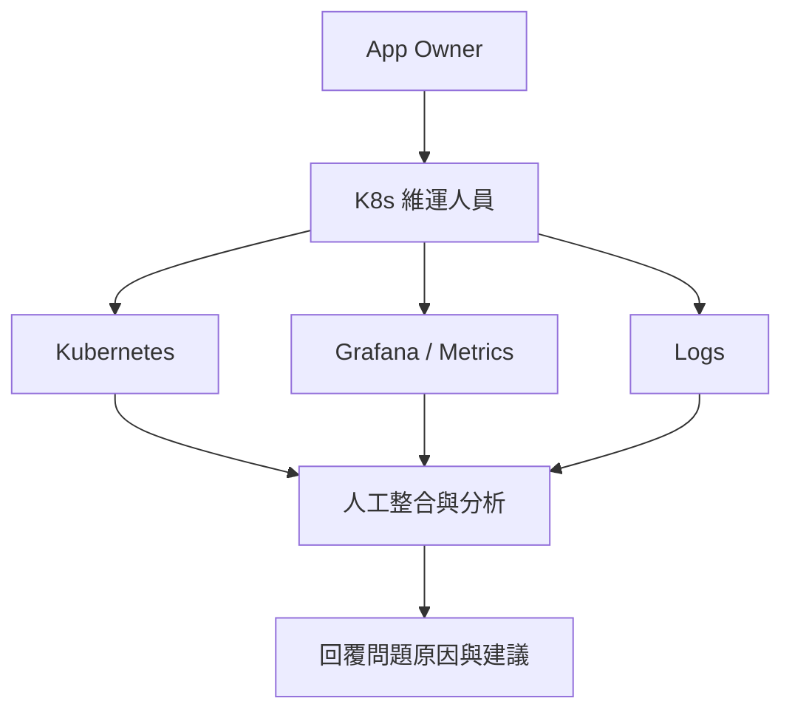
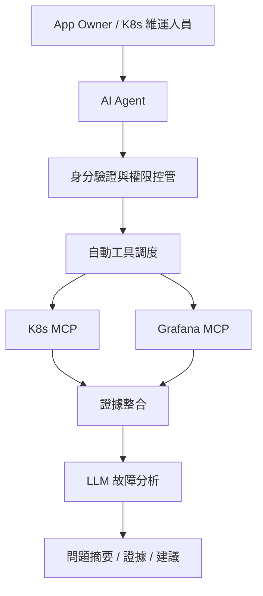
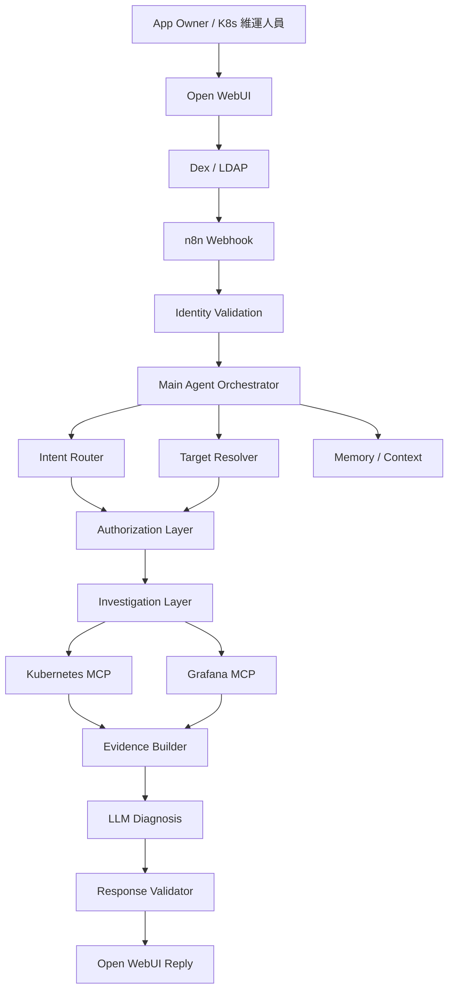
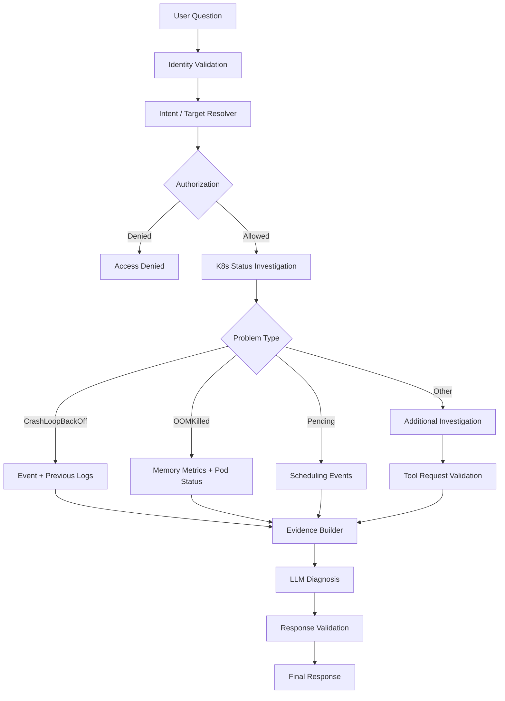

# Kubernetes AI Operations Agent 專案企劃書

> **專案名稱：** Kubernetes AI Operations Agent  
> **專案類型：** 企業內部 Kubernetes 智慧維運系統  
> **文件版本：** v1.0  
> **專案階段：** PoC 功能整合與正式架構優化規劃  
> **主要使用對象：** App Owner、Kubernetes 維運人員

---

# 1. 專案摘要（Executive Summary）

本專案旨在建立一套整合大型語言模型（Large Language Model, LLM）、工作流程自動化平台（n8n）、Kubernetes 管理介面及監控系統的企業智慧維運平台。

系統以自然語言作為主要操作介面，讓 App Owner 與 Kubernetes 維運人員能夠透過簡單的問題描述，完成服務狀態查詢、異常分析、日誌查詢、資源使用率分析及故障排查。

透過整合以下技術：

- Open WebUI
- Dex / LDAP
- n8n
- Kubernetes MCP
- Grafana MCP
- Large Language Model（LLM）
- Kubernetes RBAC
- Memory / Context Management

建立具備身分驗證、權限控管、工具調度、證據整合及智慧診斷能力的 Kubernetes AI Agent。

本專案並非取代既有的 Kubernetes、Grafana 或其他維運工具，而是透過 AI 建立統一的智慧操作入口，降低操作門檻、減少重複性維運工作，並提升故障分析效率。

**專案核心理念：**

> 讓使用者不需要熟悉 Kubernetes 架構或操作指令，只需要描述遇到的問題，AI Agent 即可在授權範圍內自動查詢相關資料，提供問題原因、分析證據及處理建議。

---

# 2. 專案背景與問題分析

## 2.1 現況說明

目前企業 Kubernetes 環境已具備容器管理、資源監控及日誌查詢等基礎設施。

然而，在實際服務維運過程中，App Owner 與 Kubernetes 維運人員仍需要透過不同工具完成問題調查。

例如，當服務無法啟動時，可能需要進行以下操作：

1. 確認服務所屬的 Namespace。
2. 查詢 Deployment 與 Pod 狀態。
3. 查看 Kubernetes Events。
4. 取得應用程式 Logs。
5. 檢查 CPU、Memory 與其他 Metrics。
6. 綜合不同資訊判斷可能原因。
7. 提出後續處理建議。

上述過程通常仰賴維運人員的經驗與 Kubernetes 操作知識。

## 2.2 現有問題

| 問題項目 | 問題描述 | 造成影響 |
|---|---|---|
| 操作門檻較高 | App Owner 不熟悉 Kubernetes 元件與指令 | 需要維運人員協助 |
| 工具分散 | K8s、Log 與監控資訊分散於不同工具 | 增加資料查詢時間 |
| 故障分析依賴經驗 | 不同人員對異常的判斷方式不同 | 排查品質不一致 |
| 重複性維運工作 | 維運人員經常執行相同或類似查詢 | 增加工作負擔 |
| 資訊整合不易 | 需要人工整合 Pod、Event、Log 與 Metric | 延長問題定位時間 |
| 權限管理需求 | 不同人員可存取的資源範圍不同 | 需要安全且一致的權限控制 |

## 2.3 核心改善方向

由傳統的「人員自行選擇工具並執行查詢」，轉變成「使用者描述問題，由 AI Agent 自動協助查詢與分析」。

### 傳統維運模式



### AI Agent 智慧維運模式



---

# 3. 專案目標（Project Objectives）

## 3.1 主要目標

### 目標一：降低 Kubernetes 操作門檻

讓 App Owner 透過自然語言完成服務查詢及基礎故障分析，不需要熟悉 Kubernetes 指令及底層資源結構。

### 目標二：提升故障分析效率

自動整合 Pod、Deployment、Event、Log 與 Metric 資訊，協助使用者快速定位異常。

### 目標三：減少維運重複性工作

將常見查詢及初步故障診斷流程自動化，降低維運人員處理例行問題的時間成本。

### 目標四：建立安全的企業 AI 操作環境

整合 Dex / LDAP 身分驗證及 Kubernetes RBAC，限制不同使用者可查詢的系統與資源範圍。

### 目標五：建立可擴充的 AI Agent 架構

透過模組化 Workflow、統一的工具介面及結構化資料格式，提高系統可維護性及未來擴充能力。

## 3.2 專案初期非目標

為降低專案導入風險，第一階段不以 AI 自動修改 Kubernetes 資源為目標。

以下功能暫不列入初期範圍：

- AI 自動刪除 Pod。
- AI 自動重啟 Deployment。
- AI 自動修改正式環境設定。
- AI 自主執行 Kubernetes 變更操作。
- 大規模自動修復。
- 完整企業 RAG 知識庫。

第一階段以**安全查詢、異常分析及處理建議**為主。

---

# 4. 目標使用者與使用情境

## 4.1 App Owner

App Owner 主要關心自己所負責的應用程式是否正常運作，以及發生異常時的原因。

| 使用情境 | 使用者問題 | AI Agent 預期功能 |
|---|---|---|
| 服務健康檢查 | 我的服務現在正常嗎？ | 查詢服務與 Pod 狀態 |
| 服務啟動異常 | 為什麼我的服務起不來？ | 分析 Pod、Event、Log |
| 日誌查詢 | 幫我找最近的錯誤 Log | 查詢並整理 Error Log |
| 資源分析 | 我的服務 Memory 有沒有異常？ | 查詢 Memory 使用率與趨勢 |
| 問題分析 | 為什麼我的服務一直重新啟動？ | 分析 Restart、Event 與 Log |

### 預期效益

- 減少 Kubernetes 操作知識需求。
- 提升服務問題的自主查詢能力。
- 縮短等待維運協助的時間。
- 更容易理解技術性的系統異常。

## 4.2 Kubernetes 維運人員

Kubernetes 維運人員主要需求為快速掌握叢集或服務異常，減少重複性查詢及初步分析工作。

| 使用情境 | 使用者問題 | AI Agent 預期功能 |
|---|---|---|
| 異常盤點 | 目前有哪些 Pod 異常？ | 查詢授權範圍內的異常 Pod |
| Restart 分析 | 哪些 Pod 最近重新啟動很多次？ | 分析 Restart Count |
| CPU 分析 | 哪個 Workload CPU 使用量偏高？ | 查詢 Grafana Metrics |
| Node 檢查 | 哪些 Node 出現 MemoryPressure？ | 查詢 Node Condition |
| 故障診斷 | 幫我分析這個 Namespace 的異常 | 整合 Pod、Event、Log 與 Metric |

### 預期效益

- 減少手動執行 kubectl 的頻率。
- 減少跨工具切換的時間。
- 加快故障初步定位。
- 讓常見故障診斷流程標準化。

---

# 5. 現有系統與優化方向

## 5.1 現有系統組成

目前專案已建立以下基礎能力：

| 元件 | 技術 | 主要功能 |
|---|---|---|
| 使用者介面 | Open WebUI | 自然語言互動 |
| 身分驗證 | Dex / LDAP | 使用者驗證與群組資訊 |
| 工作流程平台 | n8n | 工作流程與 AI Agent 調度 |
| AI 推論 | LLM | 理解使用者問題與分析結果 |
| Kubernetes 工具 | Kubernetes MCP | 查詢 K8s 資源 |
| 監控工具 | Grafana MCP | 查詢 Metrics 與監控資料 |
| 存取控制 | Kubernetes RBAC | 控制使用者資源存取權限 |
| 記憶管理 | Memory | 管理對話與上下文 |

## 5.2 優化策略

現有系統已具備可運作的基礎，因此不建議直接重新開發整套 Workflow。

建議優先保留現有身分驗證、Webhook、MCP 及權限控制架構，再逐步改善診斷能力與 Workflow 模組化設計。

| 現有功能 | 優化建議 | 優先級 |
|---|---|---|
| Open WebUI | 保留 | 一般 |
| Dex / LDAP | 保留並驗證身分傳遞 | 高 |
| n8n Webhook | 保留並增加輸入驗證 | 高 |
| Kubernetes RBAC | 確認工具實際執行身分與權限 | 最高 |
| Kubernetes MCP | 整合至標準化查詢流程 | 高 |
| Grafana MCP | 整合故障診斷與資源分析 | 高 |
| AI Agent | 改善工具選擇、診斷策略與回覆格式 | 最高 |
| Memory | 增加使用者隔離與資料保存規則 | 高 |
| Error Handling | 增加 Timeout、重試與錯誤分類 | 高 |
| RAG / Runbook | 視診斷成效再評估導入 | 後續 |

---

# 6. 系統架構設計（System Design）

## 6.1 設計原則

本專案採用以下系統設計原則：

1. **Separation of Concerns**：身分驗證、權限控管、工具查詢及 AI 分析分層處理。
2. **Least Privilege**：所有使用者與工具應採用最低必要權限。
3. **Modularity**：將不同功能拆分成可維護、可重複使用的模組。
4. **Evidence-based Diagnosis**：AI 診斷必須根據真實資料。
5. **Fail Closed**：無法確認身分或權限時，拒絕資源存取。
6. **Observability**：系統應能追蹤 Workflow 執行狀態、錯誤及時間成本。
7. **Extensibility**：保留未來整合 Runbook、RAG 與其他企業系統的擴充能力。

## 6.2 建議系統架構



> 注意：此圖為邏輯架構。實際的使用者憑證需在可信任的後端完成驗證，且 Kubernetes API 的實際執行身分必須符合授權設計。LLM 不得自行決定權限。

## 6.3 Hybrid Agent 架構

建議採用 Hybrid Agent，結合規則式 Workflow 與 LLM 動態推理。

### AI 負責的功能

- 理解使用者自然語言。
- 協助辨識目標服務。
- 解讀查詢結果。
- 分析可能的故障原因。
- 提供處理建議。

### Workflow 負責的功能

- 身分驗證。
- 權限檢查。
- 執行條件判斷。
- 診斷策略選擇。
- 工具呼叫控制。
- Timeout 與錯誤處理。
- 高風險操作限制。

### 採用原因

完全依賴 LLM 自由選擇工具，可能產生不必要的查詢、重複呼叫或錯誤分析。

完全採用固定規則則缺乏處理未知問題的彈性。

Hybrid Agent 能保留 AI 的自然語言理解與分析能力，同時透過 Workflow 控制安全性與流程穩定度。

---

# 7. n8n Workflow 優化設計

## 7.1 設計目標

由目前的功能整合型 Workflow，逐步演進為模組化、可維護的故障診斷架構。

主要改善方向：

1. 降低 Main Workflow 複雜度。
2. 將不同查詢能力模組化。
3. 將權限檢查與 AI 推理分離。
4. 統一工具回傳資料格式。
5. 建立可重複使用的故障診斷流程。
6. 增加錯誤處理、執行追蹤及品質驗證。

## 7.2 建議 Workflow 模組

| 模組 | 名稱 | 主要功能 |
|---|---|---|
| WF-01 | Main Gateway | Webhook、身分處理及流程調度 |
| WF-02 | Target Resolver | 辨識 Service、Namespace 與目標資源 |
| WF-03 | Authorization | 驗證使用者存取權限 |
| WF-04 | K8s Investigation | 查詢 Pod、Deployment、Event |
| WF-05 | Log Investigation | 查詢與整理日誌 |
| WF-06 | Metric Investigation | 查詢 Grafana Metrics |
| WF-07 | Diagnosis | 整合證據並執行 AI 分析 |
| WF-08 | Response Formatter | 統一回答格式與錯誤處理 |

> 此為目標模組設計，不代表初期必須建立八條獨立 Workflow。實際拆分方式需在檢視目前 n8n JSON 後決定。

## 7.3 Workflow 邏輯設計



## 7.4 Design Patterns

### Router Pattern

依照使用者問題類型，決定應進入哪一種處理流程。

例如：

- Pod 狀態查詢
- Log 查詢
- Metrics 查詢
- 故障分析
- 服務健康檢查

### Strategy Pattern

根據不同 Kubernetes 異常類型，採用不同的診斷策略。

例如：

- CrashLoopBackOff → Event + Previous Logs
- Pending → Scheduling Events
- OOMKilled → Memory Metrics
- ImagePullBackOff → Image + Events

### Adapter Pattern

將不同 MCP 工具封裝成一致的資料格式與查詢介面，降低 Agent 對特定工具實作的依賴。

### Pipeline Pattern

將診斷流程分成：

1. 收集資料
2. 整理證據
3. AI 分析
4. 驗證結果
5. 產生回覆

### Policy Enforcement Pattern

所有資源查詢均需經由可信任的授權機制，不得由 LLM 自行決定使用者權限。

---

# 8. 智慧故障診斷設計

## 8.1 核心設計理念

本專案應由「AI 可以查詢 Kubernetes」提升為「AI 可以根據問題自動完成初步故障調查」。

例如使用者輸入：

> 為什麼我的服務起不來？

Agent 應能夠：

1. 辨識使用者所指的服務。
2. 確認服務所屬 Namespace。
3. 驗證使用者權限。
4. 查詢 Deployment 與 Pod。
5. 判斷異常類型。
6. 查詢相關 Event 與 Log。
7. 必要時查詢 Metric。
8. 整合資料並分析。
9. 提供原因、證據與建議。

## 8.2 異常類型與診斷策略

| 異常類型 | 主要查詢資料 | 診斷目標 |
|---|---|---|
| CrashLoopBackOff | Pod Status、Restart、Previous Logs、Events | 分析容器反覆啟動失敗 |
| OOMKilled | Container Status、Memory Metrics、Memory Limit | 分析記憶體不足 |
| Pending | Events、Resource Requests、Node Condition | 分析 Pod 排程問題 |
| ImagePullBackOff | Container Image、Events | 分析映像檔取得問題 |
| Service Unavailable | Service、EndpointSlice、Pod Readiness | 分析服務無法連線 |
| CPU High | CPU Metrics、Workload、相關 Log | 分析 CPU 資源異常 |

## 8.3 Evidence Builder

建議增加 Evidence Builder，統一整理不同工具取得的資料。

### 範例資料格式

```json
{
  "request_id": "req-example-001",
  "target": {
    "namespace": "example-namespace",
    "workload": "example-app"
  },
  "observation": {
    "pod_status": "CrashLoopBackOff",
    "restart_count": 15,
    "events": [
      "Back-off restarting failed container"
    ],
    "logs": [
      "connection refused"
    ],
    "metrics": {
      "cpu": "normal",
      "memory": "normal"
    }
  },
  "tool_status": {
    "kubernetes": "success",
    "grafana": "success"
  }
}
```

此為示意資料，不代表實際查詢結果。

正式實作時需額外紀錄觀測時間、資料來源、權限上下文及必要的查詢識別資訊。

## 8.4 標準診斷回覆格式

建議每次診斷統一包含：

### 問題摘要

描述目前觀察到的服務異常。

### 分析證據

列出從 Kubernetes、Log 或監控系統取得的實際資訊。

### 可能原因

根據證據提出故障原因，並區分已確認事項與推測。

### 建議措施

提供使用者後續可以執行的檢查或處理方式。

### 分析限制

說明資料不足、工具失敗或尚未確認的部分。

### 診斷範例

**問題摘要：**

應用程式 Pod 持續重新啟動。

**分析證據：**

- Pod 處於 CrashLoopBackOff。
- Restart Count 為 15。
- Event 出現 Back-off restarting failed container。
- Previous Log 出現 connection refused。

**可能原因：**

應用程式可能無法連線至所依賴的服務。

**建議措施：**

1. 確認依賴服務是否正常運作。
2. 檢查相關 Service 與 EndpointSlice。
3. 驗證連線設定與網路存取條件。

**分析限制：**

目前尚無足夠證據確認確切的連線失敗原因。

---

# 9. 資安與權限設計

## 9.1 身分驗證

透過 Dex 與企業 LDAP 驗證使用者身分及群組資訊。

## 9.2 Kubernetes RBAC

根據使用者實際授權範圍，限制可查詢的 Namespace、Resource 與操作。

Kubernetes RBAC 應作為實際資源存取的強制授權機制。

## 9.3 Token Passthrough

使用者身分與授權資訊應正確傳遞至 Kubernetes 查詢端。

需確保：

- 不同使用者的 Token 不會混用。
- Workflow 不會意外沿用前一次請求的使用者身分。
- Memory 不會保存其他使用者的授權資料。
- 權限檢查結果不可由 LLM 自行修改。
- 共用 MCP 服務不得意外擴大使用者原有權限。

## 9.4 敏感資料保護

應避免將以下資料保存於一般執行紀錄、Prompt 或 Memory：

- Access Token
- Refresh Token
- 密碼
- Kubernetes Secret 明文
- 私密金鑰
- 不必要的個人資訊

對 Logs 或工具回應中的敏感內容應進行必要遮罩。

## 9.5 高風險操作限制

初期以唯讀查詢與分析為主。

未來如加入以下功能：

- Restart Deployment
- Scale Deployment
- Rollout Restart
- 修改 Kubernetes 資源
- 刪除 Pod

應增加獨立授權與人工確認機制，並保留完整稽核紀錄。

---

# 10. 系統可靠性與效能優化

## 10.1 Timeout

為每種 MCP 工具呼叫設定適當的超時限制，避免單一工具長時間無回應造成整條 Workflow 阻塞。

## 10.2 Retry

僅針對適合重試的暫時性錯誤執行有限次重試。

## 10.3 Error Handling

應區分下列錯誤：

- 身分驗證失敗
- 權限不足
- 找不到指定資源
- Kubernetes MCP 無法連線
- Grafana MCP 無法連線
- Metrics 無資料
- LLM 回應失敗
- 查詢超時

工具查詢失敗不應被解讀為服務正常。

## 10.4 Tool Call Limit

限制單次使用者請求的：

- 工具呼叫次數
- Log 查詢筆數
- 查詢時間範圍
- LLM Token 使用量
- 最大執行時間
- 最大並行數量

## 10.5 Memory 管理

Memory 應根據使用者與 Session 建立隔離機制。

記憶僅用於協助理解上下文，不可替代即時 Kubernetes 查詢結果或當次權限驗證。

## 10.6 系統可觀測性

建議持續統計以下資訊：

- Workflow 執行成功率
- Workflow 執行時間
- MCP 工具失敗率
- LLM 推論延遲
- Token 使用量
- 各類問題的查詢次數
- 使用者回饋

---

# 11. 開發階段規劃（Implementation Roadmap）

## Phase 1：現有系統盤點與安全性確認

### 工作內容

- [ ] 匯出目前 n8n Workflow。
- [ ] 整理現有工作流程架構。
- [ ] 確認 Dex / LDAP 身分傳遞。
- [ ] 驗證 Kubernetes RBAC。
- [ ] 測試不同使用者的 Token 隔離。
- [ ] 確認 Memory 使用者隔離。
- [ ] 建立工具回傳資料格式。
- [ ] 增加基本錯誤處理。

### 預期交付成果

- 現行系統架構圖
- Workflow 優化設計
- 權限測試紀錄
- 統一資料格式

## Phase 2：建立 Troubleshooting MVP

### 工作內容

- [ ] 建立 Target Resolver。
- [ ] 建立 Troubleshooting 子流程。
- [ ] 實作 CrashLoopBackOff 診斷。
- [ ] 整合 Pod、Event 與 Previous Log。
- [ ] 建立 Evidence Builder。
- [ ] 建立診斷回答格式。
- [ ] 建立故障測試案例。

### 預期交付成果

- 初版自動故障診斷 Workflow
- CrashLoopBackOff 診斷功能
- 標準化診斷報告
- 初步測試結果

## Phase 3：擴充診斷能力

### 工作內容

- [ ] 加入 Pending 診斷。
- [ ] 加入 OOMKilled 診斷。
- [ ] 加入 ImagePullBackOff 診斷。
- [ ] 整合 Grafana Metrics。
- [ ] 建立服務健康檢查。
- [ ] 增加工具執行限制。
- [ ] 改善錯誤處理。

### 預期交付成果

- 多類型故障診斷
- Metrics 整合分析
- 服務健康檢查
- 系統效能測試紀錄

## Phase 4：品質驗證與改善

### 工作內容

- [ ] 建立標準測試資料集。
- [ ] 測試診斷正確率。
- [ ] 測試回應時間。
- [ ] 測試多人同時執行。
- [ ] 收集 App Owner 使用回饋。
- [ ] 收集 K8s 維運人員使用回饋。
- [ ] 改善 Prompt 與診斷策略。
- [ ] 評估實際節省的維運時間。

### 預期交付成果

- 測試報告
- 效能統計
- 使用者回饋
- 系統改善計畫

## Phase 5：知識整合與進階能力

視前面階段的驗證結果，評估是否導入：

- Runbook
- RAG
- 企業 SOP
- 歷史 Incident 分析
- 跨系統問題關聯分析
- 人工審核後的維運操作

---

# 12. 建議開發時程

以下為初步試行計畫，實際時程依開發及測試資源調整。

| 週次 | 開發重點 | 預期成果 |
|---|---|---|
| 第 1 週 | 現有 Workflow 盤點及安全性檢查 | 系統架構與改善項目 |
| 第 2 週 | 建立 Troubleshooting MVP | CrashLoopBackOff 診斷 |
| 第 3 週 | 整合 Grafana 及其他故障類型 | 多類型診斷與 Metrics |
| 第 4 週 | 品質測試與使用者驗證 | 測試報告與改善計畫 |

---

# 13. 驗收指標（Acceptance Criteria）

以下為建議初期目標，實際門檻應根據基準測試結果調整。

| 指標 | 初步目標 | 驗證方式 |
|---|---|---|
| 常見故障類型辨識率 | ≥ 85% | 標準故障測試案例 |
| 根因判斷正確率 | ≥ 75% | 與專家答案比較 |
| 無權限查詢阻擋率 | 100% | RBAC 負向測試 |
| 跨使用者資料洩漏 | 0 件 | 多使用者隔離測試 |
| Workflow 執行成功率 | ≥ 95% | n8n 執行紀錄 |
| 診斷回應時間 P95 | ≤ 60 秒 | 端到端效能測試 |
| 維運人工處理時間 | 較基準降低 30% | 導入前後比較 |

## 13.1 指標計算方式

### 故障類型辨識率

故障類型辨識率 = 正確辨識的故障案例數 / 有效故障案例總數 × 100%

### 根因判斷正確率

根因判斷正確率 = 正確判斷根因的案例數 / 可判定根因的案例總數 × 100%

### 無權限查詢阻擋率

無權限查詢阻擋率 = 成功阻擋的未授權查詢數 / 未授權測試總數 × 100%

### Workflow 執行成功率

Workflow 執行成功率 = 符合預期結果的有效請求數 / 有效請求總數 × 100%

其中正確拒絕未授權請求也屬於符合預期結果。

### 診斷回應時間 P95

從使用者送出請求至收到最終回覆，統計所有有效請求的端到端時間。

P95 表示 95% 的有效請求可在該時間內完成。

### 維運人工處理時間改善率

改善率 = （導入前平均人工處理時間 - 導入後平均人工處理時間）/ 導入前平均人工處理時間 × 100%

---

# 14. 專案風險評估

| 風險 | 可能影響 | 因應措施 |
|---|---|---|
| LLM 判斷錯誤 | 錯誤診斷與建議 | Evidence-based Diagnosis |
| 權限傳遞錯誤 | 非授權資料存取 | RBAC 強制執行及身分驗證 |
| 不同使用者 Token 混用 | 資料安全風險 | Request Identity 隔離 |
| MCP 工具連線失敗 | 無法完成查詢 | Timeout、Retry、錯誤分類 |
| Log 資料過大 | Token 消耗與延遲增加 | Log 限制與摘要 |
| Workflow 過度複雜 | 維護與擴充困難 | 模組化設計 |
| 模型推論資源不足 | 回覆速度降低 | Context 與 Tool Call 限制 |
| 使用者不信任 AI | 使用率降低 | 顯示分析證據與限制 |

---

# 15. 預期效益

## 15.1 App Owner 效益

- 降低 Kubernetes 操作門檻。
- 透過自然語言完成服務查詢。
- 快速理解服務異常原因。
- 減少對 K8s 維運人員的基礎查詢依賴。
- 提升應用程式問題的自主排查能力。

## 15.2 Kubernetes 維運人員效益

- 減少手動執行重複性 kubectl 查詢。
- 自動彙整 Pod、Event、Log 與 Metric。
- 縮短初步故障定位時間。
- 提高常見問題排查流程的一致性。
- 將工作重心轉移至複雜故障、系統優化及平台維護。

## 15.3 組織效益

- 提升維運作業標準化。
- 降低對個別工程師經驗的依賴。
- 加強 App Owner 與 K8s 團隊協作。
- 建立未來企業 AI 維運應用的技術基礎。

---

# 16. 下一階段實作建議

目前系統已完成基礎整合，下一階段不建議立即增加大量 MCP 或 AI 功能。

建議以以下三個項目作為優先開發方向。

## 16.1 Target Resolver + Authorization

目的：

讓使用者不需要提供完整 Kubernetes 資源名稱，也能找到自己具有權限的服務。

功能：

1. 辨識使用者描述的服務。
2. 找出可能的 Namespace。
3. 驗證使用者權限。
4. 確認目標資源。
5. 無法唯一辨識時，要求使用者選擇。

## 16.2 Kubernetes Troubleshooting Workflow

目的：

讓 AI Agent 不只是查詢 Pod，而是能夠針對異常類型自動取得診斷資料。

功能：

1. 查詢 Pod / Deployment。
2. 判斷 Pod 狀態。
3. 選擇對應診斷策略。
4. 查詢 Events、Logs 與必要 Metrics。
5. 彙整診斷證據。

## 16.3 Evidence-based Diagnosis

目的：

讓 AI 根據實際查詢資料產生有依據的診斷建議。

功能：

1. 整合不同 MCP 回應。
2. 建立標準化 Evidence。
3. 執行 LLM 故障分析。
4. 區分已確認資訊與推測。
5. 輸出標準化診斷報告。

---

# 17. 現有 Workflow 審查計畫

為避免直接重構造成既有功能失效，後續將以目前 n8n Workflow JSON 作為架構審查依據。

## 17.1 審查項目

- [ ] Main Workflow 節點架構
- [ ] Webhook 請求與回應流程
- [ ] Dex / LDAP 身分資訊傳遞
- [ ] Token Passthrough 機制
- [ ] Kubernetes RBAC 權限控制
- [ ] Kubernetes MCP 工具呼叫
- [ ] Grafana MCP 工具呼叫
- [ ] AI Agent 工具選擇策略
- [ ] Memory 資料隔離
- [ ] Error Handling
- [ ] Workflow 執行效能
- [ ] Sub-workflow 拆分可行性

## 17.2 審查後交付成果

1. 現有 Workflow 架構圖。
2. 既有設計優缺點分析。
3. 必須修改的節點清單。
4. 建議保留的節點清單。
5. Workflow 模組化設計圖。
6. 新版工作流程實作順序。
7. 各階段功能測試及驗證方式。

---

# 18. 結論

本專案目前已完成 Kubernetes、n8n、MCP、LLM、企業身分驗證與監控系統的基礎整合。

下一階段的開發方向，應由單純增加 AI 工具與查詢功能，轉向建立一套安全、可維護、可驗證的企業智慧維運系統。

透過 Hybrid Agent 架構、模組化 Workflow、標準化故障診斷策略與 Evidence-based Diagnosis，可進一步提升 AI Agent 的可靠性與實際應用價值。

專案將優先聚焦於：

1. 降低 App Owner 的 Kubernetes 使用門檻。
2. 減少 K8s 維運人員的重複性工作。
3. 提升常見 Kubernetes 故障的分析效率。
4. 建立可信任的 AI 診斷與權限控管機制。
5. 為未來 Runbook、RAG 與進階維運自動化奠定基礎。

**最終目標：**

> 建立一套讓 App Owner 與 Kubernetes 維運人員都能透過自然語言完成系統查詢、異常調查及初步故障分析的企業 Kubernetes AI Operations Agent。
